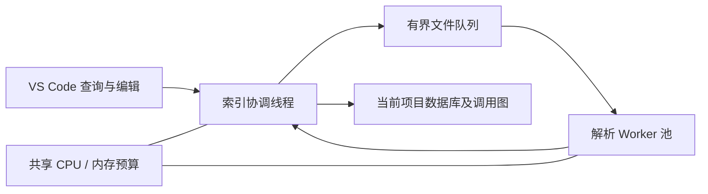

# 统一持久化索引实施设计

本文保留最初实施记录；当前基于 1.1.0 的内核优化使用 schema 5 / facts-18，函数目录和宏查询按需读取，原有测量记录不重写。最新符号与 Context 验证见 [内核符号验证](KERNEL-SYMBOL-VALIDATION.md)，此前全库测量见 [内核与 NTN 验证](LINUX-NTN-VALIDATION.md)。

目标：打开folder后复用索引文件，按文件增量校验；本地解析与语言服务共用写入接口，符号、引用、调用图可按需查询。每个候选文件必须有处理状态，解析失败或缺少编译配置不能记成完整成功。版本暂保留1.0.10，现有未提交修复一并保留。

## 存储与身份

采用运行时内置SQLite：B-tree组织符号/位置索引，带source/target索引的边表组织调用图，WAL和事务提交单个提供者快照。相较自写红黑树文件格式，它直接提供崩溃恢复和并发访问；红黑树主要适合内存有序集合，并不能独自解决持久化事务。官方依据：[SQLite文件格式](https://sqlite.org/fileformat.html)、[Node SQLite](https://nodejs.org/api/sqlite.html)。已验证开发Node22和实际VS Code Node24均可使用node:sqlite。

默认缓存根目录位于扩展全局存储；使用 cacheDirectory 配置唯一根目录。每个项目使用“项目名--路径摘要”目录，其内 indexes/index.sqlite 保存索引，logs 保存日志；路径摘要由项目根 URI 的 SHA-256 前 32 位产生，同名不同路径工程不会串库。多根分别落库，查询受当前目录屏蔽范围约束。源码、书签、笔记与数据库分离；缓存异常只能备份并重建插件自己的索引。

数据包含项目元信息、文件指纹/状态、提供者快照、符号及作用域、标识符出现位置、include边、调用边与语义查询记录。源码版本/内容hash、配置身份、provider、质量和完成状态均持久化。local与languageService不能互相覆盖，空语义结果与未提供能力必须区分。

## 实施阶段

1. SQLite仓储、事务、索引、图边与有界LRU，替换全量JSON缓存；保留旧缓存读取兼容路径，生产默认使用项目数据库。
2. 本地Worker改为数据库元数据/懒加载事实；持久化调用图，缓存有效时直接恢复。增删改原子更新，临时脏文档覆盖不写磁盘。
3. 文件处理账本覆盖C/C++等候选；C++有独立语法提取器，符号轮廓与编译器级绑定能力分开。缺SDK、条件宏或不支持语法保留部分结果与原因。
4. 统一提供者适配：文档符号、定义、引用和调用结果通过同一发布接口进入数据库；记录来源、版本和查询能力。读取时语义优先，拒绝旧版本/旧配置结果。
5. 后端策略修正：文件符号有界等待语义，缺失时本地回退；不支持的方法按能力缓存，避免重复请求报错。clangd仍需要真实编译数据库，数据库不会凭空补齐外部SDK。
6. 自动化：持久化重开、文件变化、删除/屏蔽、多根同名、脏文档、双后端写入、事务回滚、损坏恢复、并发、预算、大工程及真实VSIX宿主。更新完整验收文档并构建。

## 必守边界

- SQLite操作和批量解析放在Worker，UI线程不加载全工程事实。
- 单文件发布事务化；缓存可重建，失败不能清空其他有效提供者的数据。
- 缓存恢复后检查元数据；查询目标再次校验，旧坐标不得伪装为当前定义。
- 语言服务快照按需采集，禁止自动打开数千文档冲击clangd/扩展宿主。
- 所有文件都有状态不等于所有宏、C++模板或动态语言均能获得完整语义。不可用能力必须显式展示并有可定位原因。

## 本轮实现结果（2026-10-25）

六项实施阶段已落地，版本保持 1.0.10，按仓库要求保留未提交修改。`src/infrastructure/index-database.js` 是本地和语言服务共用的发布契约；`sqlite-index-repository.js` 负责元数据、文件事实和持久图，`unified-index-client.js` / `database-worker.js` 负责语义快照。数据库格式为 schema 4，解析事实为 facts-11。SQLite 使用运行时内置模块，没有增加原生 npm 依赖。

- 内存保存函数表和依赖图，精确查询使用哈希；文件事实最多保留 4 文件、估算不超过 32MiB 的 LRU。全局符号热点缓存最多 32 个查询，跨连接 data_version 变化时失效。
- 磁盘以整数文件/函数/图 ID 组织出现位置和边，避免在百万条记录中重复长 URI；调用图最多保留 3 个完整代次。图写入分批释放写锁，未完成代次不作为缓存成功结果。
- 本地事实与语言服务符号分别存储；语义观察按文档 hash、配置、工程版本和查询键保存，最多保留 4096 条查询记录。空/未提供符号结果不覆盖已有有效符号缓存。
- 有效文档符号可以持久回退；跨文件定义、引用、调用观察不直接跨会话回放，继续实时查询并按条件回退本地。语言服务内部会话及完整依赖版本不可凭磁盘记录恢复，不把缓存调用句柄当成有效 clangd 会话。
- 缓存目录不能写时使用带提示的临时内存库；整库损坏留存备份后重建，单条元数据隔离或事实查询时重新解析。较新格式和工程身份冲突拒绝覆盖。
- C/C++ 候选逐文件记录 ready/partial/outline/limited/encoding/budget/error 等状态。C++ 独立 grammar 提取 namespace、class、方法、成员等大纲，类型绑定仍交给语言服务。其他语言在实际语言服务查询时采集，不执行全工作区多语言编译器扫描。
- 默认根目录为扩展 globalStorageUri；cacheDirectory 位于运行扩展的机器，设置页支持文件夹选择。旧版 indexCacheDirectory/logDirectory 不再作为独立配置入口；可将原目录选为新根目录，旧文件不自动搬移或删除。旧默认 indexes/<URI摘要>/index.sqlite 和原自定义目录下的旧库可作为只读事实复用来源。首次升级不导入整份旧 JSON，而是创建新库；无数据库目录的兼容 Worker 路径仍保留旧 JSON 支持。

## 大工程结果

[完整原始统计](validation/oai-unified-index.json)，环境为单台 Linux、Node 22.23.3、默认 1024MiB JS 堆上限，源码只读；缓存统一置于 /tmp。时间包括 Worker 启动及扫描，不包括外部文件枚举。

| 场景 | 候选/收录 | 解析/复用 | 完成耗时 | JS 堆快照 |
| --- | --- | --- | --- | --- |
| 首次创建 | 7309 / 7309 | 7309 / 0 | 75.8s | 227MiB |
| 缓存重开 | 7309 / 7309 | 0 / 7309 | 3.7s；1.1s 可查询 | 148MiB |
| 强制重建 | 7309 / 7309 | 7309 / 0 | 45.0s | 157MiB |

三次均为 24,959 个 C 函数、266,605 处本地直接调用，0 文件处理失败。53 个 C++ 文件有语法大纲，1,177 个文件含解析恢复记录（含 C++），1 个大文件仅顶层符号，1 个编码提示。这里统计的是语法索引覆盖，未宣称编译器语义完整。RSS 快照约 483–898MiB，包含 V8、WASM、SQLite 和原生分配，不能拿 JS 堆数字代表进程总内存。当前完整数据库约 648MiB，百万条位置和近三十万符号构成主要空间，后续可进一步压缩符号表。

代表文件为 executables/nr-uesoftmodem.c，每项 50 次，Worker 往返 P95：文件符号 1.74ms、定义 1.96ms、出向调用 10.48ms。重复全局符号查询约 3–14ms；首次不同查询约 122–230ms，未把热点命中时间冒充首次搜索时间。结果是这台机器上的测量，不是所有硬件的性能承诺。

真实 VS Code 1.142 / Node 24.21 也验证了实际 VSIX：[常规宿主](validation/host-unified-index-linux-vsix.json) 与 [OAI 连续重建](validation/host-unified-index-oai.json)。后者使用既有的 7,263 个 C/H 输入清单（含 7 个 C++ 头文件）；首次与两次重建均收录 7,263，约 91.0 / 41.5 / 42.8s，JS 堆 104–114MiB，前台首批快照约 0.86–1.03s。与 7,309 全 C/C++ 输入的统计范围分开记录，不混用分母。

## 测试与人工验证

### 多窗口共享与调用图恢复

### 工程文件导入

`sourceInsightReader.projectSources` 保存 mode、directories、files，默认 selected 空清单，绝不回退为全工作区。独立 WebviewPanel 使用上下分区复选框：上方目录树按需展开，每次显示 200 条；下方已选清单取消勾选即移除。勾选只修改草稿，保存前检查配置冲突，关闭不保存则丢弃。单根工作区保存相对路径，多根保存 URI，拒绝工作区外路径。勾选目录递归包含子项，已被目录覆盖的子项显示选中且不可单独取消；需先取消父目录再选择子项。文件精确匹配；已有排除设置仍优先。清单一次性更新，触发旧扫描取消、查询失效和文件树重扫；不删除源码或自动导入依赖。

导入清单在原有目录和文件列表之外，可保存可选的 excludedDirectories / excludedFiles。子项可取消或恢复；更具体的导入选择覆盖父级选择，独立屏蔽设置始终优先。配置一次保存，关闭不保存仍丢弃草稿。索引、文件查询、语义过滤及受管 clangd 共用同一范围；排除目录下显式恢复的子目录 / 文件分别枚举，不递归展开全部兄弟项。

文件枚举直接从导入目录开始，单文件通过 stat 检查，不先枚举整个工程再过滤。工程文件树在选择模式下使用受限目录清单构造祖先节点。Context、Relation、引用和搜索共用 ReadingScope；受管理 clangd 的后台索引增加范围外 Skip 条件，不启用配置管理时不改 .clangd，其他语言扩展自身后台工作不由本插件强制控制。

选择模式下工程身份在原工作区 URI 附加 `readerScope` 摘要，本地和语义数据库使用同一身份。不同范围独立缓存及锁，相同范围重开复用；原全工程及父子工程事实可经内容核对后复用。旧缓存不会随清单变更删除，可通过缓存管理清理。显式 workspace 模式继续使用原工程身份。升级到此行为后，未配置清单的用户需要导入文件或显式选择整个工作区。

### 共享写入

同一缓存路径通过 `index.sqlite.writer-lock` 的独立 SQLite `BEGIN IMMEDIATE` 长事务选出本地索引写入者。操作系统在 Worker/进程退出后释放文件锁，不依赖超时删除锁文件；锁文件保留，避免替换 inode 产生两个持有者。其他窗口只读打开索引，每 3 秒检查版本或接管机会。初始化未完成时使用临时空视图等待。该机制适用于同一主机的本地磁盘缓存；不同主机共享网络文件系统不属于验证范围。

保存通知按 URI 原子写入 `.requests` 目录并合并，写入者重新读取磁盘；未保存文本只保留在各窗口 overlay 内。读取窗口没有已提交数据时仍可能暂时查不到定义。语言服务快照不持有此长期所有权锁，继续使用主数据库 WAL 与短事务、版本校验和有界 busy 重试，避免本地扫描阻止语言服务缓存。资源预算按各索引 Worker 计算；同工程只启动一套持久解析任务，不是所有工程共享的机器级配额。

扫描时暂缓持久调用图构建，文件事实仍可优先发布。最终构建按 2048 条边提交，只有 `ready=1` 的图可查询。失败清理所有已提交批次，下次构建清理遗留未完成代；正常完成仅保留新代。清理释放 SQLite 内部页供复用，不在线执行 VACUUM，不承诺现有大文件立刻缩小。

2026-10-26 只读检查 linux-7.0 缓存：日志记录 58536 文件、5707 文件因预算延后及一次缓存恢复，没有找到调用图进程崩溃的直接日志证据。数据库抽样为约 17.27 GiB、一个约 398 万边未完成图和两个很小的已完成图，空闲页约 31 MiB；不能把全部体积归因于旧图残留。未修改该活动缓存，也未重新执行完整内核扫描。自动回归覆盖跨进程冷启动、保存同步、脏文本隔离、强制退出接管、图批次不可见及清理；现场最终结果仍需新包运行验证。

新增 `test/unified-index.test.js` 22 项，覆盖持久重开、与内存绑定一致、脏文本/失败文本隔离、增量图、坏库与坏记录、事务回滚、范围/多根隔离、不可写目录、LRU、跨连接缓存失效、整数 ID 稳定、schema 迁移和本地/语义并发双写。已有自动测试、真实 clangd 和界面用例继续保留。

人工验收新增 DB-01～DB-20；与现有用例合计 174 项，见 [完整测试用例](ACCEPTANCE-TESTS.md) 与 [结果登记表](ACCEPTANCE-RESULTS-TEMPLATE.csv)。首次建议按 DB-01/02/03/06/07/10/11/12/16/20 执行，再完整回归 Context、Relation、颜色、引用、文件浏览、书签和历史。

## 仍需真实工程条件的能力

- 本次只读检查没有找到 OAI 工程中的 compile_commands.json、compile_flags.txt 或 .clangd。完整宏、头文件路径、目标平台和 SDK 语义需要生成真实编译数据库；索引数据库不能补齐缺失 SDK。未修改 OAI 源码或配置。
- 8～16MiB C 文件有顶层模式，超过 16MiB 或提取超预算会明确记录；不能保证任意大小/任意损坏输入的完整语义。
- 本机 clangd 19 不支持出向调用，缓存其 method-not-found 能力并回退本地。语义出向调用的 clangd 20+、Windows/macOS、最低 VS Code 版本和长期多窗口运行仍须按支持矩阵验收。

## 1.1.0 父子目录缓存复用补充

新增 InheritedIndexCache：在统一缓存目录内只读发现祖先/后代项目的同 URI 本地事实，最多发现 2 秒、一个活动源连接；按当前范围逐文件校验真实源码 SHA-256，匹配才写入新项目库，变化则重新解析。项目绑定和调用图按当前根重建，不复制语义观察或旧图。现有自身缓存优先，强制重建禁用继承；无效源缓存退回正常解析。状态中 inheritedFiles 是 reusedFiles 的子集，计数包含已完成内容验证的文件。细节、真实 OAI 对比及 REUSE-01～08 见 OAI-RELEASE-AUDIT-1.1.0.md。

## 受控解析池

CPU 预算默认 25%，可在 5–100% 间配置，包含协调线程；按可用逻辑核和共享内存计算池大小，最多 32 个解析线程。内存支持固定 MiB 上限或可用内存的 5–90%，比例模式在启动时取样、运行时根据内存压力收紧准入，至少保留 256 MiB 或物理内存的 2%。默认 1024MiB 下 12 核为 2 个解析线程 + 1 个协调线程。各线程和进程 CPU 时间共同节流；JS 合计内存、RSS 增长与系统内存压力参与准入。小工程/低预算串行，解析组失败先释放再串行降级。前台任务可在扫描等待文件时执行；文件结果按枚举顺序提交，编辑覆盖优先，未保存事实保持内存隔离。合作式预算允许原生/GC 短时波动，不等同 OS 硬配额。PAR-01～PAR-10 和 OAI 审计记录边界及真实测量。

### 手动启动与编译数据库模式

扩展创建 LocalIndex 时显式启用 manualStart。每个新窗口会话都等待开始操作；语言查询与语义持久化入口共用该门控。范围改变停止原 Worker，等待再次启动。Context 的开始索引与刷新索引均读取已保存配置，直接启动，不打开配置页；刷新重新发现编译数据库范围并复用有效事实缓存，未保存草稿不参与。配置入口保留在管理工程文件。开始时先发现范围，再创建索引；该发现步骤不加载全部工作区。

compile_commands.json 在独立 Worker 中解析，单个 JSON 上限 64 MiB，Worker 堆按索引预算限制且最多 512 MiB，发现最多 100000 个文件、400000 个文件/搜索路径组合；超限报错而不扩展范围。支持字面 include 和显式搜索目录，当前工作区各根独立，拒绝跨根或链接外依赖。结果作为会话内精确文件清单交给 ReadingScope，配置只保存数据库路径；下次手动开始重新发现，语义快照的 build key 纳入数据库文件变化。不执行编译，不模拟完整预处理；宏 include、响应文件、隐式系统路径和完整 C++ 绑定仍由语言服务承担。

2026-10-26 driver_attribute 只读审计：用户当前选择的 4074 文件数据库已经包含 include/linux/device/driver.h 第 144 行的本地 kind=22 定义，状态 ready。复用该数据库执行 bus.c 第 37、40、108、120 行的本地定义查询，均返回该位置；在 driver.h 自身引用处也返回该定义。没有修改活动数据库，尚未复现用户报告的具体失败界面，需其提供失败文件/行号及操作以继续定位，不能据此声称该问题已修复。

### 编译数据库路径映射验证（2026-10-27）

`projectSources.pathMappings` 为显式 `{from,to}` 数组（最多 32 项），支持绝对路径/file URI；UI 通过文件夹选择器管理。以命令原始 directory 解析 file 和 include 路径，再按最长目录前缀映射。目标须处于工作区且不能通过符号链接逃逸；冲突源前缀报错。不执行 local.mk，不猜测不同工程的归属，也不改写 clangd 数据库。读取当前源码而非构建副本，因此新编辑生效；未出现在数据库中的编译单元仍不被发现。

实测 AM62x Buildroot linux-custom 数据库：2156 条记录，2097 条 C/C++ 命令映射成功，发现 5145 个源码/头文件，0 条工作区外、0 条无效记录；7 个 C 生成文件在源码侧缺失，52 条扩展名不受支持。独立 make O= 场景验证原始 directory 相对路径先解析，源目录头文件保持可达。构建输出独有的生成源码/头文件尚不跨工作区收录：通过 missingSources/missingSourceFiles/unsupported 和缺失头文件日志明确报告，不宣称完整预处理或完整内核符号覆盖。

### 全面检查与一致性修复（2026-10-27）

本轮检查覆盖三种索引模式、Buildroot/独立输出目录、配置持久化、命令注册、设置与工程管理 UI、clangd/本地查询、缓存保护及颜色说明。检查时版本为 1.1.2；本轮修改纳入 1.1.3 统一发布。

| 发现的问题 | 修复 / 结论 |
| --- | --- |
| linux-custom 编译数据库已发现 5276 文件，随后枚举满 30 秒失败 | 编译 Worker 已检查文件存在性和 realpath；目录清单复用其结果，不再逐文件重复远程 stat。原超时保护保留 |
| 绝对路径中的上级 build/out 被 indexExclude 命中 | 改为相对所属工作区匹配；工作区内部的 build 子目录仍可按规则排除 |
| 修改映射后旧编译清单可能继续被使用 | 清单绑定完整选择配置；变更后等待显式准备，不能使用旧映射结果 |
| 映射变化但发现文件完全相同时，空范围缓存可能不刷新 | 快照缓存键包含准备时的选择配置身份；真实宿主覆盖同一清单重新准备 |
| 大清单过滤长时间占用主线程 | 每 128 项主动让出事件循环并检查取消 / 范围变更 |
| 索引关闭时启动提示优先于禁用提示 | 先显示明确的禁用状态，避免误导开始操作 |
| 编译数据库模式仍能点击清空文件，隐式切回导入模式 | 仅导入模式显示清空与勾选说明，服务端同步拒绝不适用的清空动作 |
| 索引启动中修改模式、映射和清单产生竞态 | UI 禁用对应操作，服务端再次检查；关闭窗口仍可用 |
| 其他入口修改工程范围后，管理页草稿缺少提示 | 监听配置冲突，保留草稿并提示重新读取；不覆盖外部配置 |
| 非导入模式保存时错误验证未使用的旧导入条目 | 仅在导入模式验证导入文件 / 目录 |
| 保存清单的文案不能解释模式和路径映射 | 统一为保存配置，明确保存不启动索引 |
| 编译数据库路径显示编码 URI，中文和空格难读 | 显示文件系统路径，持久化仍使用 URI |
| 映射条目长路径、多个条目挤占窗口 | 独立行、自动换行、移除按钮固定、映射区限制高度并滚动 |
| 设置页在 VS Code 原生设置修改后仍显示旧值 | 合并刷新生效值；保留未保存字段、焦点和当前保存目标，避免保存期间刷新竞争 |
| 设置页与原生配置的关系不明确 | 增加共用配置说明、生效来源（用户 / 工作区 / 默认）及原生设置入口 |
| 工程模式与缓存管理入口分散 | 设置页增加工程文件与索引模式、缓存管理入口，仍调用现有统一命令 |
| 选择范围后的索引目录提示显示整工程旧路径 | 使用 catalog.projectKey 显示范围隔离的真实索引目录；日志保持工程目录 |
| 固定 / 比例内存输入都能修改，难判断哪个生效 | 根据内存模式禁用未生效的数值控件；预算说明明确未启动索引不会自动开始 |
| 命令有的手写插件前缀，有的没有；重复重建菜单与实际行为不符 | 70 个命令统一 category；旧 rebuildIndex ID 保留兼容但隐藏重复命令面板入口；名称改为选择模式后开始 / 更新 |
| 符号命令仍称函数排序 / 函数列表 | 文案统一为符号排序 / 符号列表 |
| 设置页说明与预算预览占据首屏、双工具栏可能覆盖 | 说明折叠、预算移入索引设置分组、快捷入口取消 sticky；按钮边框、圆角、焦点和主次操作统一 |
| 外观说明及旧宿主测试仍称宏定义蓝色 | 与现有主题及单元测试一致：宏名称红色，枚举定义蓝色 / 引用红色；未改变用户已确认的配色 |
| 旧宿主测试仍以 CPU 25% 为最大允许值 | 按当前配置 5–100% 测试，101% 拒绝；默认仍 25% |

配置审计：功能设置读取 / 写入 `sourceInsightReader.*`，外观使用相应 `editor.*`、`workbench.*` 与 `sourceInsightReader.appearance.panes`；插件页面是这些配置的编辑界面。工作区优先级沿用 VS Code。`workspaceState` 保存书签、笔记、阅读任务、查询历史、展开状态和布局恢复快照；webview state 保存分屏比例。这些是使用状态，不是另一套功能配置。数据库存放索引事实，不作为用户设置来源。

真实 Buildroot 数据验证（只读源码；独立 /tmp 缓存，未改动用户现有数据库）：发现 2104 条 C/C++ 编译记录与 5276 个候选文件；按文件类型 / 排除规则得到 5274 个索引文件；二次枚举约 413 ms，重复远程 stat 为 0。全量索引得到 89062 个函数、390355 处调用、0 个处理失败，无内存预算截断。2026 个文件包含恢复解析结果，表示本地语法解析能力边界，不等于全部符号已验证正确。

仍然存在的能力边界：源码映射不自动导入工作区外仅构建生成的文件、不改写 clangd 数据库；本地解析不完整执行条件预处理或 C++ 语义绑定；CPU / 内存属于协作预算，非 OS 硬隔离。此次真实 UI 验证在 Linux Xvfb / VS Code 进行，Windows 原生文件选择窗口与所有第三方主题仍需对应环境验收。文件删除或生成物变化后，解析阶段仍可能报告缺失；新编译单元和依赖需要再次显式开始以刷新清单。

### linux-custom--116c73b97c0711b8f330fe27d69ea1cd 复查（2026-10-27）

当前日志 `sourceinsight-reader-2e76cf005483-2401822.log` 记录 01:06:39 UTC 开始、01:10:38 UTC 完成索引：5274 文件、89062 函数、390355 调用、33 份 C++ 大纲、2026 份恢复解析。只读数据库检查确认 5274 条文件事实、一个 ready=1 的持久调用图和 390355 条图边，没有未完成的多代调用图；约 1.4 GiB 文件大小包含符号、位置和查询索引，freelist_count=0，本次没有证据表明它因重建失败积累空页。日志位于不带范围标识的工程 logs 目录，用户指出的目录仅保存选定范围 indexes。

语言服务已接入：远程 exthost44 的 clangd 输出确认 `/usr/bin/clangd` 19.1.7 已初始化，并加载 linux-custom 的 compile_commands.json。首次预编译失败原因为 `unknown target ABI 'lp64'`，之后符号、调用层级及 semanticTokens 返回 `invalid AST`；因此不能把语言服务存在等同于语言服务可用，也不能仅靠本地索引完成统计判断整个阅读功能正常。

在 /tmp 中复制对应编译记录，保持原始 directory、工作区源文件、头文件路径和其他参数，仅移除 `-mabi=lp64`、`-fno-allow-store-data-races`、`-fzero-init-padding-bits=all`、`-fmin-function-alignment=4`、`-fconserve-stack`、`-femit-struct-debug-baseonly` 后，clangd --check 对 init/init_task.c、kernel/fork.c 的检查返回 0。兼容配置模板见 examples/clangd-buildroot-arm64.yaml；需要合并到当前内核工程 .clangd 才会被该工程语言服务使用。本轮没有写入用户工程配置、改动原数据库或删除正在使用的索引。

“查询未完成；本地 C 索引：…”来自 Relation 的失败提示和本地全局统计拼接，不表示本地索引仍在构建。日志中的 init/init_task.c 查询位置处于全局变量初始化区；其文件元数据 functionCount=0。修复 Relation 对 notFound 的显示，改为提示未找到可用于调用关系的函数；真正的 timeout/error 仍显示失败原因。修复语言扩展拒绝请求时抛出普通对象或字符串导致日志显示 undefined 的问题，并保留原始字符串错误详情。

同一兼容参数对 drivers/base/core.c 的 60 秒受限检查超时（未输出编译错误），因此不将其列为通过，不据两个样本宣称整个内核 clangd 查询已恢复。此结果说明还需要区分解析参数错误与大型翻译单元查询耗时。

模板验证：将 init_task.c 复制到临时目录，保持 GCC 原编译参数和真实头文件搜索目录，使用该模板作为临时 .clangd，启用配置的 clangd --check 返回 0。这确认 YAML Remove 模板可用；原项目未自动应用模板。插件检查通过，554 项 Node 测试通过，21 项 Relation 定向回归与 25 项真实宿主测试通过。

### 工程文件管理左右布局与 Shift 连选（2026-10-27）

管理页改为左侧可展开目录树、右侧已选清单，各自独立滚动；右侧显示工程相对路径，悬停查看绝对路径。左侧普通点击设置起点，再 Shift 点击终点，根据终点复选框状态批量勾选或取消；范围以当前可见行确定，折叠隐藏行、父目录覆盖禁用的子项及分页加载按钮不参与。左右起点独立，清空、重新读取或切换模式后重置。

右侧取消勾选会立即移除条目，服务端保留该次点击前的顺序和起点，后续 Shift 点击仍可按原区间取消现存条目。每次范围操作只发送一条协议消息并发布一次草稿，按已加载的节点 ID 验证，不能通过客户端提供任意路径。保存前仍不修改工程配置或启动索引；刷新左右列表时恢复滚动位置。

回归验证：552 项单元测试通过；7 项无头 VS Code 宿主检查通过，其中通过实际 webview 的原生复选框 click/change 和 Shift 修饰事件验证左右布局、区间勾选、起点移除后的右侧区间取消。截图 dist/project-import-side-by-side.png，人工用例 RANGE-01～03。

### 结构体成员和函数指针关系

C事实格式升级至facts-19：成员记录保留直接函数指针标记，同一匿名union的直接回调别名共用成员槽；调用记录保留最终成员位置，初始化及直接赋值保留成员与右值位置。赋值事实存入SQLite的文件事实载荷，不复制到常驻文件元数据。旧格式缓存按现有解析器版本机制失效。

成员可作为Relation根。查询使用按名称建立的出现位置索引，再按声明位置和接收者类型绑定；同名但属于其他结构体或工程的成员被过滤。函数指针成员的incoming只包含实际通过该成员调用的函数；outgoing只列出简单初始化 / 赋值右值解析到的函数定义，并标明静态候选。跨文件赋值位置单独携带URI，避免把驱动中的赋值行错误套到头文件声明上。普通成员列出包含其使用位置的函数，读写和初始化通过绑定引用查询查看。

直接调用的耐久图保留原有语义；成员关系按需查询，不在启动时生成所有驱动候选的笛卡尔边。查询结果随索引代际失效，缓存有上限；达到时间或数量预算时显示结果不完整。默认auto模式对成员关系及引用使用本地绑定，显式languageService模式仍保留原行为。

当前可解析直接回调、typedef回调及下标形式的成员调用；宏展开、复杂指针拷贝、对象实例归属和运行时控制流不在该静态候选分析范围内。局部类型不唯一时不按成员同名猜测目标。真实Linux7.0 I2C四文件探针覆盖i2c-core-base.c L2261、i2c.h成员声明，以及OMAP和bit-bang驱动初始化；不能据此声称全内核所有宏和配置均已解析。

普通回调实现的incoming查询以函数名出现位置索引定位初始化 / 赋值记录，先校验右值绑定到当前函数定义，再解析左侧成员，反查该成员的调用函数。注册成员位置和潜在回调调用位置分别携带真实URI，并标注静态候选；同名静态实现不共享注册记录。该分析按查询执行并有代际缓存和预算，不增加启动时的全工程候选边。默认auto在语言服务调用列表为空时继续检查本地结果；回调实现的incoming存在本地注册证据时优先使用本地候选，避免语言服务仅返回初始化变量而隐藏成员调用者。SQLite出现位置查询为每个活动迭代器使用独立statement，嵌套反查不会重置外层游标。范围中只有注册代码而没有接口调用方时，明确提示补充导入源码。

### 非函数符号使用关系与紧凑显示

Relation 支持宏、变量、结构体 / 枚举类型、枚举项及 typedef 作为根，复用现有 `referenceSites` 的声明绑定与出现位置查询。按包含函数、初始化或宏分组，函数外无所属符号时保留文件位置；排除自身定义，不求值条件分支，不伪造函数下游。相同名称的局部变量及独立工程保持隔离。查询有时间 / 数量预算、代际失效和有界缓存，无需新增全工程引用边或升级事实格式。

自动跟随在 C 标识符上保留实际查询位置；默认后端先检查本地非函数根，普通函数继续保留语言服务优先策略。横向图每个节点高度固定为随字体缩放的一行，具体位置以名称后的行号按钮表示，超出前三处通过 `+N` 选择，仍保留精确 URI、列位置和定义跳转。

### 严格工程范围

`ReadingScope.accepts`与`contains`使用相同的导入 / 排除判断，不再为工作区外的SDK路径自动放行。所有语言服务结果必须满足源与目标都被当前范围接受、且项目身份一致；没有项目身份的外部目标拒绝。该过滤覆盖定义、类型、声明、引用、工程符号和Relation，并复用到语义快照写入及旧记录回放。语义结果被过滤为空时，auto模式仍可返回合法的本地定义。插件不自动打开外部目标文档；clangd自身的依赖解析与其他扩展的原生跳转由其各自配置决定。

### 不完整包含链中的宏候选

`EOPNOTSUPP`已在工程内导入，但`linux/errno.h -> uapi/linux/errno.h -> asm/errno.h`缺少架构生成的桥接头文件时，单纯的声明绑定无法确认引用。Relation查询可选择宏候选模式：当前项目只有一个同名宏定义、出现位置未绑定到其他声明、且之前存在缺失包含链时列出明确标注的候选。已可见但绑定失败的定义、undef之后、未出现依赖线索的位置和不同工程被排除；普通定义及References保持原有确定绑定语义。

查询复用出现位置索引与现有预算，仍只在导入范围内工作。候选按包含函数分组，保留真实URI与行列，根节点和组提示都明确关联尚未确认。通过实例`i2c-core-base.c`第2239行验证`__i2c_transfer`的候选位置。

C 标识符着色使用当前源码角色与工程内唯一确认绑定；函数指针成员调用按函数分类，成员值读取保持成员分类，EXPORT_SYMBOL 参数不继承声明样式。主编辑器与 Context 共用合并规则，本地标识符分类优先于冲突语义 token；未绑定及仅有 Relation 候选的标识符使用默认前景色。颜色查询有预算与按文档版本 / 索引修订失效的缓存，不启动全工程扫描；索引变化会重新着色。此校正限定 Source Insight 主题、启用语义着色的 C / C 兼容头文件。

同一作用域的 extern 变量声明与实际定义按一个目标处理；当存在多个实际定义时继续保留歧义，不任取第一个。带初始化的 extern 属于定义。相关解析语义使用 facts-21，使旧的错误声明标记在开始或刷新索引时失效。

宏的函数式展开位置以标识符记录已有 tag 整数中的位标记保留，记录宽度继续为 9 个整数；不额外建立位置表。AST、预处理词法和声明宏投影共用调用括号检测，包含注释及续行；SQLite 与内存查询按同一规则解码。对象宏优先于普通 C 作用域，函数宏在实际调用或预处理指令中处理，宏参数仍保持自身绑定，条件宏与同名普通符号碰撞保留歧义。

缓存 schema 6 使用 symbol_files 字典保存 URI，symbols 主键采用 provider、整数文件 ID、位置、名称和角色，不再反复存储完整 URI / 字符串 ID。符号载荷省略顶层 URI，查询出口统一还原。调用载荷以版本标记保存非派生信息，caller / file / name / targets / resolved 从原有整数键及列恢复；非常规旧记录保留原载荷。普通查询和对外符号身份不依赖物理主键。

旧库在受管写锁和租约内按批次迁移，符号复制与旧行删除原子提交，调用迁移记录游标；布局完成前拒绝只读连接，旧版本拒绝打开新格式。迁移损坏的符号记录使相关本地文件重新解析，损坏的调用图标记为待重建。存在足够空闲页和磁盘余量时执行空间整理，失败只延后整理，保留已提交布局。升级阶段显示进度并使用独立等待预算。现有用户数据库仅在扩展正常加载该工程缓存时升级，不由测试脚本改写。
