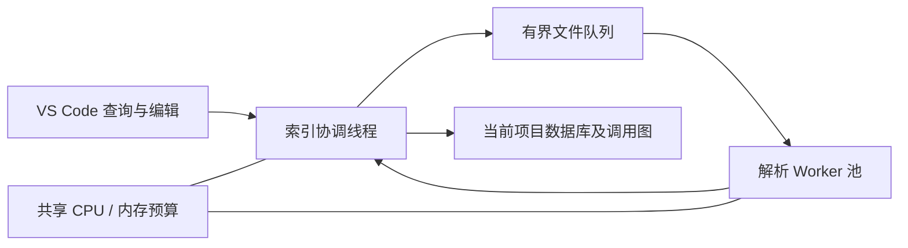

# 统一持久化索引实施设计

目标：打开folder后复用索引文件，按文件增量校验；本地解析与语言服务共用写入接口，符号、引用、调用图可按需查询。每个候选文件必须有处理状态，解析失败或缺少编译配置不能记成完整成功。版本暂保留1.0.10，现有未提交修复一并保留。

## 存储与身份

采用运行时内置SQLite：B-tree组织符号/位置索引，带source/target索引的边表组织调用图，WAL和事务提交单个提供者快照。相较自写红黑树文件格式，它直接提供崩溃恢复和并发访问；红黑树主要适合内存有序集合，并不能独自解决持久化事务。官方依据：[SQLite文件格式](https://sqlite.org/fileformat.html)、[Node SQLite](https://nodejs.org/api/sqlite.html)。已验证开发Node22和实际VS Code Node24均可使用node:sqlite。

默认缓存位于扩展存储目录；新增indexCacheDirectory指定根目录。每个工作区根URI经SHA-256产生独立子目录/index.sqlite，不按folder名称识别，重名工程不会串库。多根分别落库，查询受当前目录屏蔽范围约束。源码、书签、笔记与数据库分离；缓存异常只能备份并重建插件自己的索引。

数据包含项目元信息、文件指纹/状态、提供者快照、符号及作用域、标识符出现位置、include边、调用边与语义查询记录。源码版本/内容hash、配置身份、provider、质量和完成状态均持久化。local与languageService不能互相覆盖，空语义结果与未提供能力必须区分。

## 实施阶段

1. SQLite仓储、事务、索引、图边与有界LRU，替换全量JSON缓存；保留旧缓存读取兼容路径，生产默认使用项目数据库。
2. 本地Worker改为数据库元数据/懒加载事实；持久化调用图，缓存有效时直接恢复。增删改原子更新，临时脏文档覆盖不写磁盘。
3. 文件处理账本覆盖C/C++等候选；C++有独立语法提取器，符号轮廓与编译器级绑定能力分开。缺SDK、条件宏或不支持语法保留部分结果与原因。
4. 统一提供者适配：文档符号、定义、引用和调用结果通过同一发布接口进入数据库；记录来源、版本和查询能力。读取时语义优先，拒绝旧版本/旧配置结果。
5. 后端策略修正：文件符号有界等待语义，缺失时本地回退；不支持的方法按能力缓存，避免重复请求报错。clangd仍需要真实编译数据库，数据库不会凭空补齐外部SDK。
6. 自动化：持久化重开、文件变化、删除/屏蔽、多根同名、脏文档、双后端写入、事务回滚、损坏恢复、并发、预算、大工程及真实VSIX宿主。更新完整验收文档并构建。

## 必守边界

- SQLite操作和批量解析放在Worker，UI线程不加载全工程事实。
- 单文件发布事务化；缓存可重建，失败不能清空其他有效提供者的数据。
- 缓存恢复后检查元数据；查询目标再次校验，旧坐标不得伪装为当前定义。
- 语言服务快照按需采集，禁止自动打开数千文档冲击clangd/扩展宿主。
- 所有文件都有状态不等于所有宏、C++模板或动态语言均能获得完整语义。不可用能力必须显式展示并有可定位原因。

## 本轮实现结果（2026-10-25）

六项实施阶段已落地，版本保持 1.0.10，按仓库要求保留未提交修改。`src/infrastructure/index-database.js` 是本地和语言服务共用的发布契约；`sqlite-index-repository.js` 负责元数据、文件事实和持久图，`unified-index-client.js` / `database-worker.js` 负责语义快照。数据库格式为 schema 4，解析事实为 facts-11。SQLite 使用运行时内置模块，没有增加原生 npm 依赖。

- 内存保存函数表和依赖图，精确查询使用哈希；文件事实最多保留 4 文件、估算不超过 32MiB 的 LRU。全局符号热点缓存最多 32 个查询，跨连接 data_version 变化时失效。
- 磁盘以整数文件/函数/图 ID 组织出现位置和边，避免在百万条记录中重复长 URI；调用图最多保留 3 个完整代次。图写入分批释放写锁，未完成代次不作为缓存成功结果。
- 本地事实与语言服务符号分别存储；语义观察按文档 hash、配置、工程版本和查询键保存，最多保留 4096 条查询记录。空/未提供符号结果不覆盖已有有效符号缓存。
- 有效文档符号可以持久回退；跨文件定义、引用、调用观察不直接跨会话回放，继续实时查询并按条件回退本地。语言服务内部会话及完整依赖版本不可凭磁盘记录恢复，不把缓存调用句柄当成有效 clangd 会话。
- 缓存目录不能写时使用带提示的临时内存库；整库损坏留存备份后重建，单条元数据隔离或事实查询时重新解析。较新格式和工程身份冲突拒绝覆盖。
- C/C++ 候选逐文件记录 ready/partial/outline/limited/encoding/budget/error 等状态。C++ 独立 grammar 提取 namespace、class、方法、成员等大纲，类型绑定仍交给语言服务。其他语言在实际语言服务查询时采集，不执行全工作区多语言编译器扫描。
- 默认使用扩展 globalStorageUri/indexes；自定义 indexCacheDirectory 位于运行扩展的机器。首次升级不导入整份旧 JSON，而是创建新库；无数据库目录的兼容 Worker 路径仍保留旧 JSON 支持。

## 大工程结果

[完整原始统计](validation/oai-unified-index.json)，环境为单台 Linux、Node 22.23.3、默认 1024MiB JS 堆上限，源码只读；缓存统一置于 /tmp。时间包括 Worker 启动及扫描，不包括外部文件枚举。

| 场景 | 候选/收录 | 解析/复用 | 完成耗时 | JS 堆快照 |
| --- | --- | --- | --- | --- |
| 首次创建 | 7309 / 7309 | 7309 / 0 | 75.8s | 227MiB |
| 缓存重开 | 7309 / 7309 | 0 / 7309 | 3.7s；1.1s 可查询 | 148MiB |
| 强制重建 | 7309 / 7309 | 7309 / 0 | 45.0s | 157MiB |

三次均为 24,959 个 C 函数、266,605 处本地直接调用，0 文件处理失败。53 个 C++ 文件有语法大纲，1,177 个文件含解析恢复记录（含 C++），1 个大文件仅顶层符号，1 个编码提示。这里统计的是语法索引覆盖，未宣称编译器语义完整。RSS 快照约 483–898MiB，包含 V8、WASM、SQLite 和原生分配，不能拿 JS 堆数字代表进程总内存。当前完整数据库约 648MiB，百万条位置和近三十万符号构成主要空间，后续可进一步压缩符号表。

代表文件为 executables/nr-uesoftmodem.c，每项 50 次，Worker 往返 P95：文件符号 1.74ms、定义 1.96ms、出向调用 10.48ms。重复全局符号查询约 3–14ms；首次不同查询约 122–230ms，未把热点命中时间冒充首次搜索时间。结果是这台机器上的测量，不是所有硬件的性能承诺。

真实 VS Code 1.142 / Node 24.21 也验证了实际 VSIX：[常规宿主](validation/host-unified-index-linux-vsix.json) 与 [OAI 连续重建](validation/host-unified-index-oai.json)。后者使用既有的 7,263 个 C/H 输入清单（含 7 个 C++ 头文件）；首次与两次重建均收录 7,263，约 91.0 / 41.5 / 42.8s，JS 堆 104–114MiB，前台首批快照约 0.86–1.03s。与 7,309 全 C/C++ 输入的统计范围分开记录，不混用分母。

## 测试与人工验证

新增 `test/unified-index.test.js` 22 项，覆盖持久重开、与内存绑定一致、脏文本/失败文本隔离、增量图、坏库与坏记录、事务回滚、范围/多根隔离、不可写目录、LRU、跨连接缓存失效、整数 ID 稳定、schema 迁移和本地/语义并发双写。已有自动测试、真实 clangd 和界面用例继续保留。

人工验收新增 DB-01～DB-20；与现有用例合计 174 项，见 [完整测试用例](ACCEPTANCE-TESTS.md) 与 [结果登记表](ACCEPTANCE-RESULTS-TEMPLATE.csv)。首次建议按 DB-01/02/03/06/07/10/11/12/16/20 执行，再完整回归 Context、Relation、颜色、引用、文件浏览、书签和历史。

## 仍需真实工程条件的能力

- 本次只读检查没有找到 OAI 工程中的 compile_commands.json、compile_flags.txt 或 .clangd。完整宏、头文件路径、目标平台和 SDK 语义需要生成真实编译数据库；索引数据库不能补齐缺失 SDK。未修改 OAI 源码或配置。
- 8～16MiB C 文件有顶层模式，超过 16MiB 或提取超预算会明确记录；不能保证任意大小/任意损坏输入的完整语义。
- 本机 clangd 19 不支持出向调用，缓存其 method-not-found 能力并回退本地。语义出向调用的 clangd 20+、Windows/macOS、最低 VS Code 版本和长期多窗口运行仍须按支持矩阵验收。

## 1.1.0 父子目录缓存复用补充

新增 InheritedIndexCache：在统一缓存目录内只读发现祖先/后代项目的同 URI 本地事实，最多发现 2 秒、一个活动源连接；按当前范围逐文件校验真实源码 SHA-256，匹配才写入新项目库，变化则重新解析。项目绑定和调用图按当前根重建，不复制语义观察或旧图。现有自身缓存优先，强制重建禁用继承；无效源缓存退回正常解析。状态中 inheritedFiles 是 reusedFiles 的子集，计数包含已完成内容验证的文件。细节、真实 OAI 对比及 REUSE-01～08 见 OAI-RELEASE-AUDIT-1.1.0.md。

## 受控解析池

CPU 预算最高 25%，包含协调线程；按可用逻辑核和共享内存计算池大小，最多 4 个解析线程。默认 1024MiB 下 12 核为 2 个解析线程 + 1 个协调线程。各线程和进程 CPU 时间共同节流；JS 合计内存、RSS 增长与系统内存压力参与准入。小工程/低预算串行，解析组失败先释放再串行降级。前台任务可在扫描等待文件时执行；文件结果按枚举顺序提交，编辑覆盖优先，未保存事实保持内存隔离。合作式预算允许原生/GC 短时波动，不等同 OS 硬配额。PAR-01～PAR-10 和 OAI 审计记录边界及真实测量。
